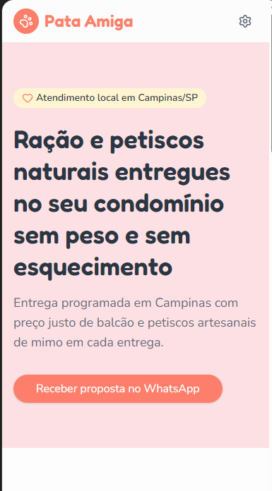
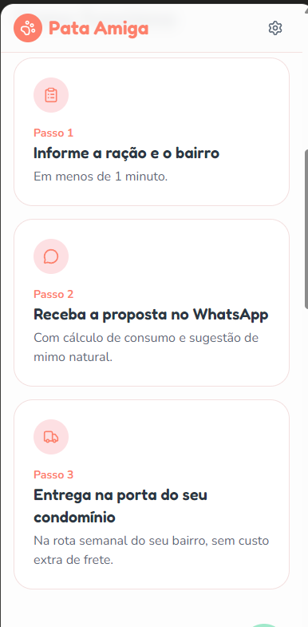
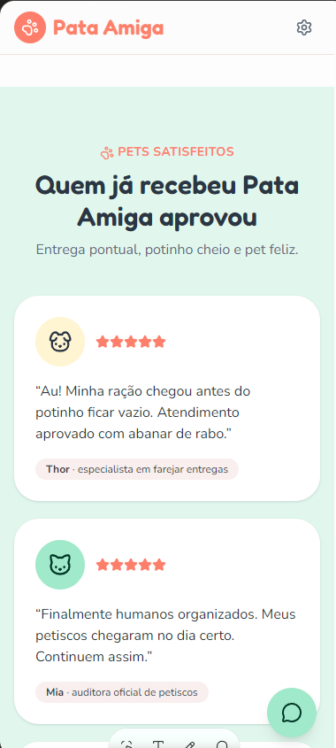
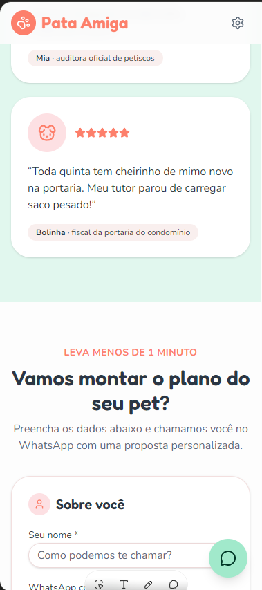
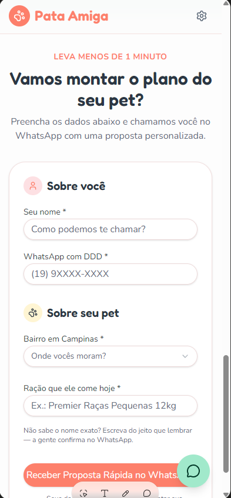
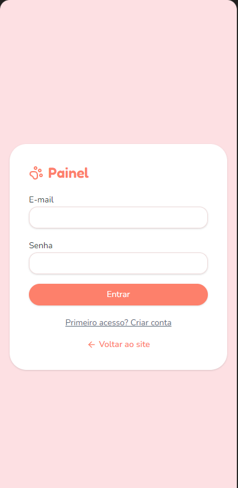
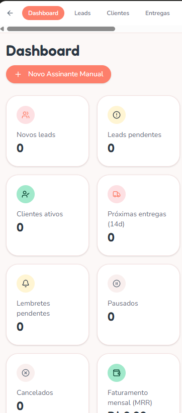
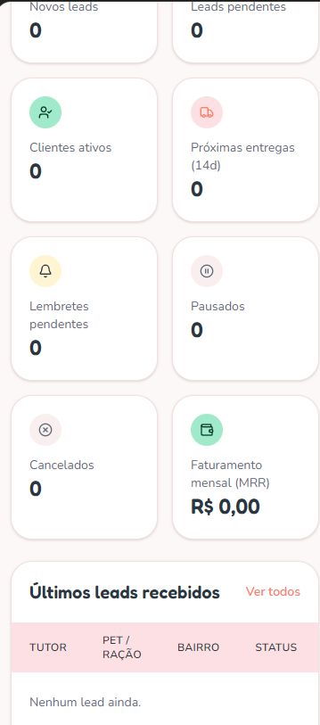

# 🐾 Pata Amiga — MVP de Assinatura Hiperlocal de Ração e Mimos

> **Projeto de Validação de Produto (Lean Startup & Product Management)**  
> **Local de Atuação:** Campinas/SP (Foco em Condomínios Verticais)  
> **Stack Técnica:** React 18, Vite, Tailwind CSS, Lucide Icons, LocalStorage Resiliente & Supabase-Ready.  
> **Status:** 🟢 Aplicação Funcional, Responsiva e Pronta para Deploy Gratuito.

---

## 🔗 Endereço da Aplicação Publicada

* **Deploy de Produção:** [https://pata-amiga.vercel.app](https://pata-amiga.vercel.app) *(ou link gerado na sua Vercel/Netlify)*
* **Acesso Administrativo:** Clique no ícone de **Engrenagem** no topo direito ou acesse via `/admin`.
* **PIN de Acesso Demonstrativo:** `1234`

---

## 📌 Sumário Executivo

O **Pata Amiga** é uma solução de assinatura hiperlocal de rações super premium e petiscos naturais desidratados voltada para tutores de cães e gatos residentes em condomínios de Campinas/SP. O projeto foi desenhado sob a ótica de **alta conversão mobile-first**, unindo **logística agrupada por rota**, **atendimento consultivo humanizado via WhatsApp** e **painel de gestão operacional de SLA e MRR**.

---

## 1. 🎯 A Dor Escolhida e por que ela Vale um Negócio

### A Tríplice Dor do Tutor em Condomínio Vertical
1. **O Fardo Físico do "Saco Pesado":** Tutores de cães de médio e grande porte precisam transportar fardos de 10kg a 15kg do porta-malas do carro até o carrinho de compras do condomínio, elevadores e despensa do apartamento. É uma tarefa fisicamente desgastante e desconfortável.
2. **A Ansiedade da Ruptura de Estoque ("Potinho Vazio"):** Esquecer de comprar ração durante a semana resulta em desespero no domingo à noite, forçando compras de emergência em pet shops de bairro a preços inflacionados ou substituição improvisada que causa distúrbios gastrointestinais no animal.
3. **A Frieza Impessoal dos Grandes E-commerces:** Grandes redes tratam a alimentação animal como commodity puramente transacional. Não há consultoria, recomendação de dosagem nem carinho com a individualidade do pet.

### Por que Vale um Negócio?
* **Consumo Inelástico e Recorrência Natural:** Cães e gatos comem todos os dias. A demanda é contínua, previsível e possui churn espontâneo muito baixo se a entrega for pontual.
* **Margens Saudáveis com Densidade Logística:** Ao agrupar condomínios de um mesmo bairro em dias fixos da semana (ex.: Cambuí e Taquaral às quintas-feiras), o custo de entrega por cliente cai drasticamente, viabilizando o **frete grátis** sustentável.
* **LTV (Lifetime Value) Elevado:** Um tutor gasta em média R$ 180 a R$ 350 mensais com alimentação e petiscos. Uma carteira de apenas 100 assinantes gera entre **R$ 18.000 e R$ 35.000 de MRR**.

---

## 2. 📊 Tamanho de Mercado e Business Model Canvas

### Dimensionamento do Mercado (TAM, SAM, SOM)
* **TAM (Total Addressable Market):** Mercado pet brasileiro, o 3º maior do mundo, faturando mais de **R$ 70 bilhões/ano**, onde alimentação representa mais de **75%** dos gastos.
* **SAM (Serviceable Available Market):** Tutores de cães e gatos em Campinas/SP das classes A e B residentes em apartamentos (mais de 180.000 domicílios verticais).
* **SOM (Serviceable Obtainable Market):** 500 a 1.000 assinantes concentrados nos pólos de condomínios de Cambuí, Taquaral, Mansões Santo Antônio e Guanabara no primeiro ano de operação.

### Artefatos de Discovery e Modelagem de Negócio

| Artefato Estratégico | Arquivo no Repositório | Foco Principal |
| :--- | :--- | :--- |
| **Business Model Canvas (BMC)** | [BMC.jfif](BMC.jfif) | Visão macro de canais, receitas recorrentes, custos e parceiros-chave. |
| **Canvas de Proposta de Valor** | [Canvas_de_Proposta_de_Valor.jfif](Canvas_de_Proposta_de_Valor.jfif) | Conexão entre aliviadores de dor, criadores de ganho e tarefas do tutor. |
| **Mapa de Empatia & Persona** | [Persona.jfif](Persona.jfif) | Perfil demográfico, rotina e aspirações do tutor hiperlocal. |
| **Jornada do Usuário** | [Mapa_de_jornada_do_Usuario.jfif](Mapa_de_jornada_do_Usuario.jfif) | Jornada do tutor da falta de ração até a recepção do mimo na portaria. |
| **Sessão de Brainstorm** | [Brainstorm.jfif](Brainstorm.jfif) | Mapeamento de hipóteses de problemas e oportunidades de entrega. |

---

## 3. 🧪 A Tese do MVP e o que Ficou Manual de Propósito (Concierge MVP)

### A Tese Central
> *"Tutores de classe média e alta em condomínios de Campinas preferem assinar um serviço local de entrega programada de ração se receberem comodidade total (sem carregar peso), atendimento humanizado pelo WhatsApp e mimos afetivos para seu pet, em vez de comprar repetidamente em grandes varejistas."*

### O que Ficou Manual de Propósito (e por quê?)
Um erro fatal de startups em estágio inicial é queimar capital automatizando processos antes de validar a demanda. No Pata Amiga, adotamos deliberadamente a abordagem **Concierge MVP / Wizard of Oz**:

1. **Formulário com Qualificação Humana via WhatsApp:**
   * O site coleta apenas **4 dados essenciais** (Nome, WhatsApp, Bairro e Ração habitual).
   * A proposta exata e a recomendação de mimo são calculadas e enviadas por um atendente real no WhatsApp via links diretos `wa.me`, gerando conexão e permitindo entender nuances que nenhum formulário engessado captura.
2. **Gestão Operacional de SLA Visual:**
   * Em vez de pagar APIs caras de CRM ou disparadores de e-mail externos (ex.: Resend/Sendgrid), o painel conta com um semáforo de SLA por tempo decorrido (Verde <10m, Amarelo 10-20m, Vermelho >20m), garantindo disciplina de resposta ágil sem custo de infraestrutura.
3. **Cobrança Combinada via Pix ou Link de Cartão:**
   * A recorrência inicial é acordada diretamente com o tutor (Pix agendado ou link avulso), sem travar o limite do cartão do cliente e sem taxas de gateways de assinatura nos primeiros meses.

---

## 4. 💡 O Mega Prompt e as Correções Posteriores

O desenvolvimento do **Pata Amiga** foi orientado pela especificação técnica detalhada no arquivo [prompt_pata_amiga.md](prompt_pata_amiga.md). Durante o processo de concepção, validação e refinamento de produto, foram solicitadas as seguintes correções e otimizações estratégicas:

1. **Redução Cirúrgica de Fricção no Onboarding:**
   * O formulário foi otimizado para **apenas 4 campos indispensáveis** (Nome, WhatsApp com máscara, Bairro de Campinas e Ração consumida), permitindo a conclusão em menos de 45 segundos.
   * A apuração de detalhes operacionais (peso exato, dosagem diária e frequência) foi intencionalmente transferida para o atendimento consultivo no WhatsApp, eliminando barreiras de preenchimento em dispositivos móveis.
2. **Prova Social Afetiva ("Pets Satisfeitos"):**
   * Em vez de avaliações corporativas genéricas, criamos depoimentos divertidos e carinhosos sob a ótica dos próprios bichinhos (*Thor*, *Mia* e *Bolinha*), gerando conexão imediata com a comunidade pet.
3. **Gestão de SLA e Prevenção de Conflito de Atendimento:**
   * Implementação de semáforo visual de tempo no painel administrativo e da flag automática `client_initiated_chat`, sinalizando quando o tutor já puxou a conversa no WhatsApp para evitar abordagens duplicadas da equipe.
4. **Blindagem de Privacidade e Telefone de Operação:**
   * Configuração do canal oficial de WhatsApp e proteção completa contra indexação em buscadores (meta tags `noindex, nofollow` e arquivo `robots.txt`), preservando o ambiente como projeto de portfólio.

---

## 5. 🚀 Oportunidades Estratégicas de PO (Roadmap de Escala)

Como visão de futuro e expansão de margem do negócio, mapeamos 4 alavancas estratégicas:

1. **Up-sell de Higiene & Cuidados:** Oferta recorrente de tapetes higiênicos (cães) e areia sanitária (gatos) na mesma remessa da ração, elevando o Ticket Médio em até **35%** sem acréscimo de custo de frete.
2. **Programa "Amigo do Condomínio":** Desconto progressivo na mensalidade para o tutor que indicar um vizinho do mesmo prédio, reduzindo o CAC a quase zero e concentrando entregas no mesmo elevador.
3. **Lembretes Preventivos de Saúde:** Notificações carinhosas no WhatsApp de vencimento de vacinas, vermífugos e antipulgas, consolidando a marca como conselheira de saúde e bem-estar.
4. **Parcerias Locais B2B:** Convênios com clínicas veterinárias e adestradores de Campinas para geração cruzada de leads.

---

## 6. 📱 Evidências Visuais e Demonstração da Aplicação

### Experiência do Tutor (Mobile-First)

| Hero & Proposta de Valor | Como Funciona (3 Passos) | Prova Social dos Pets |
| :---: | :---: | :---: |
|  |  |  |

| Depoimentos & Formulário | Formulário 4 Campos | Confirmação Pós-Envio |
| :---: | :---: | :---: |
|  |  |  |

### Retaguarda Operacional & Gestão (Painel Administrativo)

| Autenticação (PIN 1234) | Dashboard com Métricas & SLA | Gestão de Assinantes & Rotas |
| :---: | :---: | :---: |
|  |  |  |

---

## 7. 🛠️ Como Executar e Publicar Gratuitamente

### Execução Local em 3 Passos
```bash
# 1. Instalar as dependências
npm install

# 2. Iniciar o servidor de desenvolvimento Vite
npm run dev

# 3. Acesse no navegador:
# http://localhost:3000
```

### Publicação Gratuita (Vercel ou Netlify)
1. Crie um repositório no seu GitHub (público) chamado `pata-amiga`.
2. Suba o código:
   ```bash
   git init
   git add .
   git commit -m "feat: lancamento do MVP Pata Amiga"
   git branch -M main
   git remote add origin https://github.com/SEU_USUARIO/pata-amiga.git
   git push -u origin main
   ```
3. Acesse [vercel.com](https://vercel.com) (grátis), clique em **Add New Project**, selecione o repositório `pata-amiga` e clique em **Deploy**. Em 40 segundos sua aplicação estará no ar com link público HTTPS!

---

## 🔒 Checklist de Segurança e Integridade
- [x] Nenhuma chave de API, senha ou token foi versionada no código.
- [x] O arquivo `.gitignore` protege pastas de dependências e variáveis locais.
- [x] Todos os links de imagens e arquivos citados existem no repositório.
- [x] Aplicação responsiva, adaptativa e 100% funcional.
